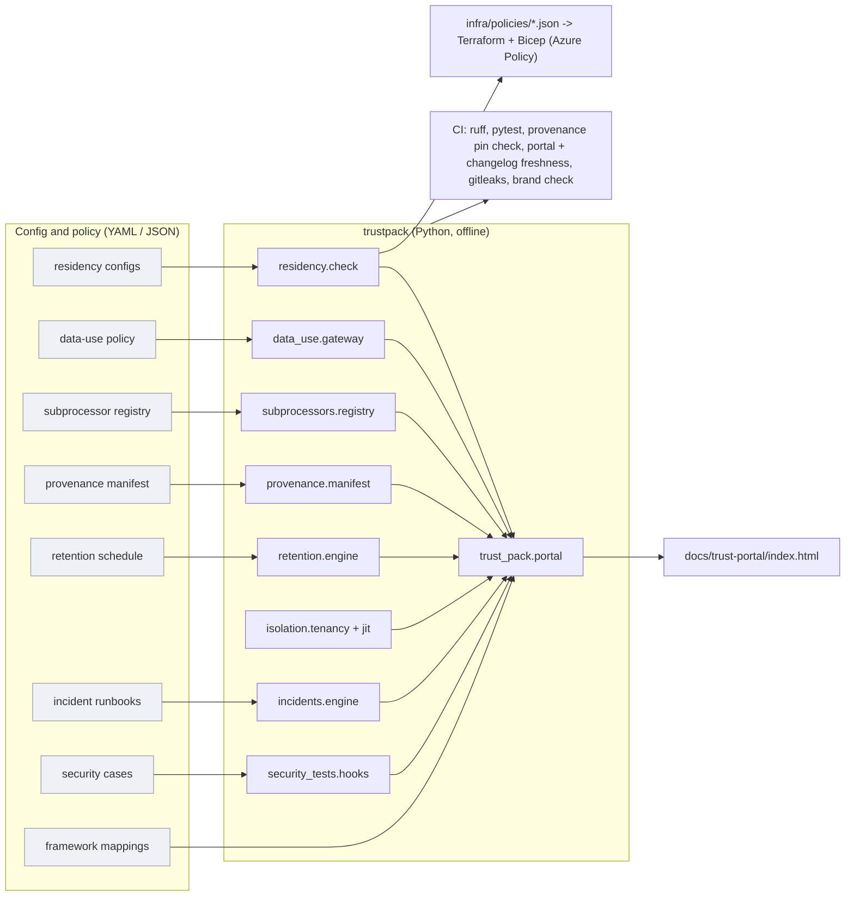

# Jagadish-enterprise-ai-trust-pack

**Offline, tested evidence for the nine questions enterprise buyers ask before they sign an AI deal.**

> Recruiter summary. Security reviews stall AI deals when the vendor answers "we're compliant"
> instead of showing evidence. This repo turns each of the nine buyer questions (residency, training
> on customer data, subprocessors, model provenance, retention and deletion, isolation, incidents,
> AI security testing, the trust pack) into Python code, config and a check that fails when the
> answer stops being true. Proof: the test count below is printed by a real run, the residency check
> catches 6 seeded misconfigurations, 0 leaks across 6 cross-tenant canary pairs, a hash-chained
> deletion certificate that fails when a purge misses a store, and a generated static trust portal.

**Everything is synthetic.** Every company and product (Halcyon Assist, Quillstone AI, Fernhollow Bank,
Marlowe Freight, Pellucid Insure, Tracewell, Pagerlyn) is fictional. Every document is labelled
**"Template, not certified"**. Nothing here is an audit, a certification, legal advice or a pen test.

<!-- run: python scripts/count_tests.py -->
```text
221 tests collected
```
<!-- /run -->

## Purpose and who it is for
- **Sales engineers / forward-deployed engineers** who get a security questionnaire and need answers backed by artefacts.
- **Platform teams** who want each promise ("no cross-region fallback", "we don't train on your data") enforced in code and CI.
- **Buyers and reviewers** who want to see what good evidence looks like.


## Architecture



More detail: [docs/architecture.md](docs/architecture.md).

## The nine questions and where the evidence is

| # | Buyer question | Answer in this repo | Evidence | Reproduce |
|---|---|---|---|---|
| Q1 | Where are prompts, logs, embeddings stored and processed? | Per-data-class region config; check rejects Microsoft Foundry deployment types wider than the boundary and cross-region fallback without consent; Azure Policy in Terraform and Bicep from one JSON source | `trustpack/residency/`, `infra/` | `python -m trustpack residency` |
| Q2 | Will our data train your models? | Per-data-type policy (never / opt-in); a fail-closed gateway is the only path to a training corpus; opt-in feedback leaves with HMAC pseudonyms; outbound calls forced to `store=false` | `trustpack/data_use/` | `python -m trustpack data-use` |
| Q3 | Who else touches our data? | YAML registry of every hop with purpose and region; diff against the last published list; 30-day notice check; out-of-zone hops need a transfer mechanism and redaction | `trustpack/subprocessors/` | `python -m trustpack subprocessors` |
| Q4 | Which model, which version, from whom? | sha256-pinned manifest for base model, fine-tune, prompt template, guardrails; CI fails on an unpinned change; generated change log | `trustpack/provenance/` | `python -m trustpack provenance` |
| Q5 | How long do you keep data, can you prove it's gone? | Schedule per data type; delete request purges prompt log, vector index, cache and traces; canaries verify; hash-chained certificate | `trustpack/retention/` | `python -m trustpack retention` |
| Q6 | Can other customers or your staff see our data? | Per-tenant index, namespace and key; cross-tenant canary probes over 5 read paths (search, get, list, cache, filter override); JIT vendor access with approval, expiry and a hash-chained log | `trustpack/isolation/` | `python -m trustpack isolation` |
| Q7 | What happens when something goes wrong? | Four AI runbooks (PII in output, harmful output, injection exfiltration, model regression), severity rules, contract and 72-hour windows, tabletop simulator | `trustpack/incidents/` | `python -m trustpack tabletop` |
| Q8 | How do you test for injection and leakage? | Injection, jailbreak and PII suites behind a hook registry, aggregated report with known misses visible, pen-test template marked not real | `trustpack/security_tests/` | `python -m trustpack security` |
| Q9 | Can you send your security documentation? | SOC 2 TSC, ISO/IEC 27001:2022 Annex A and ISO/IEC 42001 mappings to evidence paths; DPA with residency annex, DPIA, model card, pen-test letter templates; generated static trust portal | `trustpack/trust_pack/`, `docs/trust-portal/` | `python -m trustpack portal` |

Full answers with code and output: [docs/nine-questions.md](docs/nine-questions.md).

## Real code and its real output

The residency rule that reuses Microsoft Foundry deployment-type processing scopes
(`trustpack/residency/check.py`):

```python
def _deployment_ok(dep: dict, boundary: dict) -> bool:
    scope = processing_scope(dep["sku"])
    if STRICTNESS[scope] < STRICTNESS[boundary["scope"]]:
        return False
    return _in_boundary(dep["region"], boundary)
```

Running it on the deliberately broken config (fictional tenant):

<!-- run: python -m trustpack residency broken-example || true -->
```text
tenant=pellucid-insure boundary=data_zone:EU
  prompts    swedencentral
  outputs    swedencentral
  logs       eastus2
  embeddings swedencentral
  caches     -
  backups    swedencentral  replica uksouth
  model chat-main    DataZoneStandard   swedencentral  primary scope=data_zone
  model chat-spare   GlobalStandard     francecentral  fallback scope=global
  findings: 6
    RES007 pellucid-insure.allowed_regions: 'eastus2' is outside boundary data_zone=EU
    RES001 pellucid-insure.caches: no storage region declared
    RES003 pellucid-insure.logs.region: stored in 'eastus2', outside EU
    RES003 pellucid-insure.backups.replica_region: stored in 'uksouth', outside EU
    RES006 pellucid-insure.deploy.chat-spare: GlobalStandard in francecentral may process data outside data_zone=EU
    RES005 pellucid-insure.deploy.chat-spare: falls back from swedencentral to francecentral without written customer consent
```
<!-- /run -->

The deletion certificate (canaries planted, every store purged and verified, hash-chained):

<!-- run: python -m trustpack retention -->
```text
sweep deleted (past retention): {'prompts': 2, 'outputs': 0, 'caches': 2, 'traces': 2}
deletion certificate del-0001: VERIFIED (Template, not certified)
  received request_id=del-0001, tenant=fernhollow-bank, subject_ref=2e12dc5e9253cca2, at=2026-10-28T12:00:00+00:00
  purge prompt_log   deleted=1 remaining=0 subject_canary_gone=True control_canary_present=True
  purge vector_index deleted=2 remaining=0 subject_canary_gone=True control_canary_present=True
  purge cache        deleted=1 remaining=0 subject_canary_gone=True control_canary_present=True
  purge traces       deleted=1 remaining=0 subject_canary_gone=True control_canary_present=True
  backups  note=immutable backups are not rewritten, aged_out_by=2026-12-04
  issued   status=VERIFIED, within_sla_days=30, within_sla=True, at=2026-10-30T12:00:00+00:00
  head sha256 e23bf5a49e0f4dd9..., verify errors: none
other subject's records untouched: 5
```
<!-- /run -->

The aggregated security report (synthetic regression checks, not a pen test):

<!-- run: python -m trustpack security -->
```text
security report (Synthetic regression checks, not a pen test)
suite      cases attacks blocked benign false+  known misses
injection     18      13      11      5      0  inj-12, inj-13
jailbreak     13       9       8      4      0  jb-09
pii           14       9       8      5      0  pii-09
total blocked 27/31; gate (no unexpected results): PASS
```
<!-- /run -->

## How to run (offline first)

```bash
python -m venv .venv && . .venv/bin/activate
pip install -r requirements-dev.txt
python -m pytest -q                      # full suite
ruff check .
python -m trustpack residency            # Q1 ... see the table above for Q2-Q9
python -m trustpack portal               # rebuild docs/trust-portal/index.html
python scripts/render_docs.py            # refresh every output block in the docs from a real run
```

IaC (no Azure login needed): `terraform -chdir=infra/terraform init -backend=false && terraform -chdir=infra/terraform validate && terraform -chdir=infra/terraform test`
and `bicep build infra/bicep/main.bicep`. Applying the policies to a real subscription is optional,
creates only free Azure Policy objects, and is documented in [docs/how-to-run.md](docs/how-to-run.md).

## Guardrails and security controls
Fail-closed gateway, keyed HMAC pseudonyms (key from `TRUSTPACK_PSEUDONYM_KEY`), tenant identity from
the caller never the request, per-tenant integrity tags, JIT access capped at 4 hours with customer
approval and no self-approval, hash-chained audit, access and deletion logs, HTML-escaped portal with a
strict CSP, SHA-pinned GitHub Actions, gitleaks, CodeQL, Dependabot, hashed brand blocklist.
See [docs/guardrails.md](docs/guardrails.md) and [docs/threat-model.md](docs/threat-model.md).

## Limitations (honest)
- **Synthetic only.** In-memory stores stand in for Cosmos DB, AI Search, Redis and a trace backend. No real data, tenants or vendors.
- **Templates, not certifications.** The mappings say "this repo has relevant evidence", not "this control is met". No SOC 2 report, ISO certificate, DPA or pen test exists.
- **The sample guard is small and regex-based.** It misses encoded and translated injections (inj-12, inj-13), a game-framed jailbreak (jb-09) and bare names with birth dates (pii-09). Those misses are kept as visible test cases.
- **Region table is a hand-written subset** of Azure regions; check live Microsoft docs before relying on it.
- **Integrity tags, not encryption.** Tenant keys sign documents; production needs customer-managed keys in Key Vault.
More in [docs/limitations.md](docs/limitations.md).

## Built vs planned

| Item | Status |
|---|---|
| Nine modules, CLI, tests | Built and run locally |
| Azure Policy (Terraform + Bicep), fmt/validate/mocked test/tflint/checkov/bicep build | Built and run locally; never applied to a subscription |
| CI, CodeQL, Dependabot workflows | Written; run on GitHub only after the repo is pushed |
| Trust portal | Generated static page in `docs/trust-portal/`; not hosted |
| Real data stores, real red-team tooling, real audits | Planned / out of scope |

## Docs
[architecture](docs/architecture.md) · [nine questions](docs/nine-questions.md) · [how to run](docs/how-to-run.md) ·
[guardrails](docs/guardrails.md) · [limitations](docs/limitations.md) · [implementation guide](docs/implementation-guide.md) ·
[interview points](docs/interview-points.md) · [threat model](docs/threat-model.md) · [ADRs](docs/adr/)

## Related repos
- [Jagadish-pii-guard](https://github.com/jagadishmazure-jpg/Jagadish-pii-guard): deeper PII detection than the sample guard here
- [Jagadish-prompt-injection-evals](https://github.com/jagadishmazure-jpg/Jagadish-prompt-injection-evals): larger injection eval sets
- [Jagadish-agent-security-redteam](https://github.com/jagadishmazure-jpg/Jagadish-agent-security-redteam): red-team harness whose JSON can feed `ingest_external()`
- [Jagadish-ai-gateway-control-plane](https://github.com/jagadishmazure-jpg/Jagadish-ai-gateway-control-plane): where the training gateway would sit in production
- [Jagadish-permission-aware-rag](https://github.com/jagadishmazure-jpg/Jagadish-permission-aware-rag): document-level permissions beyond tenant isolation
- [Jagadish-agentic-ai-model-risk](https://github.com/jagadishmazure-jpg/Jagadish-agentic-ai-model-risk): model risk management that pairs with the provenance manifest

## License
MIT. See [LICENSE](LICENSE) and [SECURITY.md](SECURITY.md).
