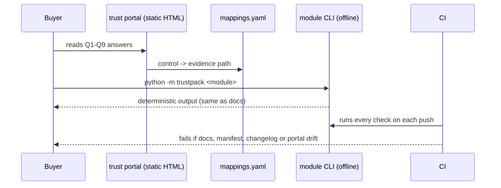

# Architecture and how it works

Every module follows the same pattern:
1. A **config or policy file** holds the promise, in YAML or JSON that a reviewer can read.
2. A **small Python engine** enforces it, or checks it against evidence.
3. **Tests** prove the check also fails when it should, not only that it passes.
4. A **CLI command** prints the evidence a buyer can reproduce.

`trust_pack` then maps the evidence to control frameworks and renders the portal.

## Step by step, per module

| Module | Input | What the engine does | Fails when |
|---|---|---|---|
| `residency` | `configs/*.yaml`, `regions.py` | Maps every data class and model deployment to a region and a Microsoft Foundry processing scope (global / data zone / geography); compares against the boundary; `policy.py` emits the denied SKU list that `infra/policies/*.json` must match | wider deployment type, store outside the boundary, fallback without consent, unknown region (RES001-RES007) |
| `data_use` | `policy.yaml`, consents | `TrainingGateway.route()` decides per record; pseudonymises `user_id` with HMAC; `prepare_provider_request()` forces `store=false`; audit hash chain | unknown type or destination, `never` type, no live opt-in, missing key |
| `subprocessors` | `registry.yaml`, `history/` | validates required fields, diffs against the last published version, checks the notice period, checks out-of-boundary hops | missing field, notice < 30 days, transfer mechanism or redaction missing |
| `provenance` | `manifest.json`, `artifacts/`, `history/` | re-hashes every artefact, compares with pins, builds the change log newest first | any artefact hash differs from its pin, or `CHANGELOG.md` is stale |
| `retention` | `schedule.yaml`, four stores | `sweep()` deletes records past retention; `process_deletion()` plants subject and control canaries, purges, verifies and chains each step | a store keeps the subject canary, loses the control canary, or the SLA is missed; `verify_certificate()` catches tampering |
| `isolation` | tenants, master key | per-tenant index, namespace and HMAC key; caller identity decides the index; canary suite probes 5 read paths for all pairs; `SupportAccess` for JIT staff access | any leak on any path; grant without customer approval, past expiry or outside scope |
| `incidents` | `runbooks.yaml`, `scenarios/` | classifies severity, computes deadlines (containment, customer, RCA, regulator 72h), replays timelines | a step or notice happens after its deadline |
| `security_tests` | `cases/*.yaml`, `guard.py` | hook registry runs suites; aggregate report with misses and false positives | any result differs from its expectation (a new miss or a false positive); declared known misses are reported, not hidden |
| `trust_pack` | `questions.yaml`, `mappings.yaml`, `templates/` | checks every evidence path exists and every template carries the label; renders the escaped HTML portal | missing path or label, or a stale portal |

## Infrastructure

`infra/policies/*.json` is the single source for two Azure Policy definitions:
- `deny-loose-ai-deployments`: denies listed `sku.name` values on `Microsoft.CognitiveServices/accounts/deployments`;
- `allowed-locations-ai-data`: an allowed-locations rule for AI data services.

Terraform (`azurerm_policy_definition` + subscription assignment) and Bicep (`loadJsonContent`)
both read those files. Python tests check that the JSON matches `residency.policy.denied_skus()`.
These are free Azure Policy objects, and nothing is applied by CI.
